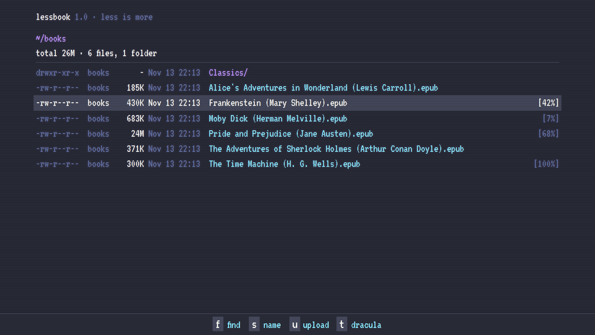
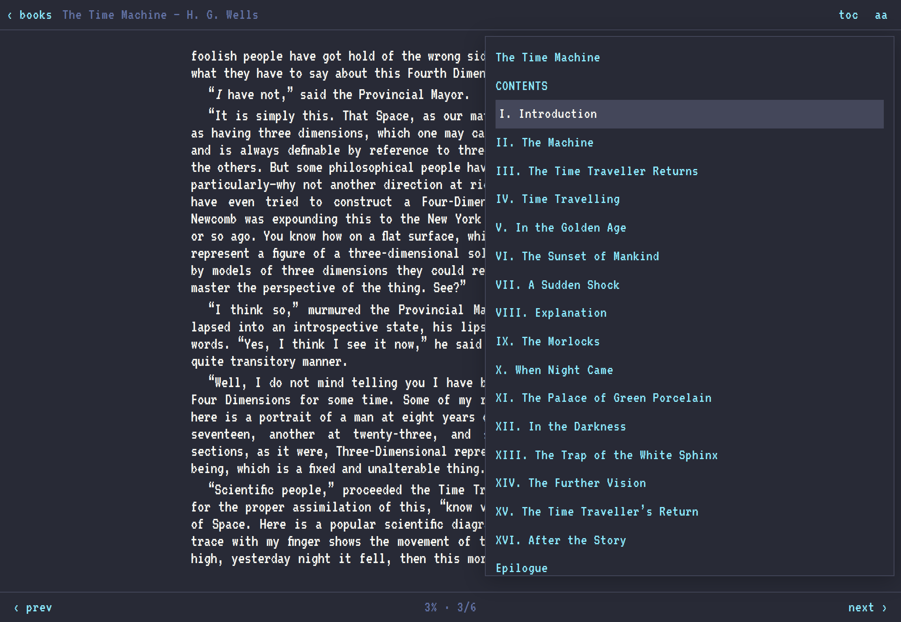
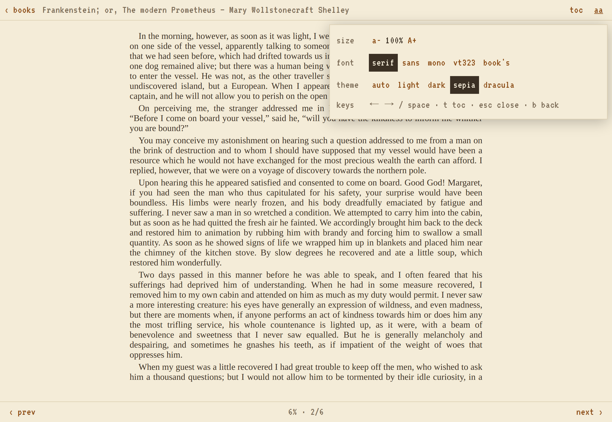
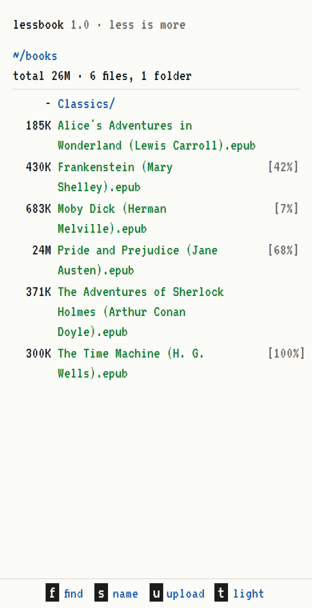
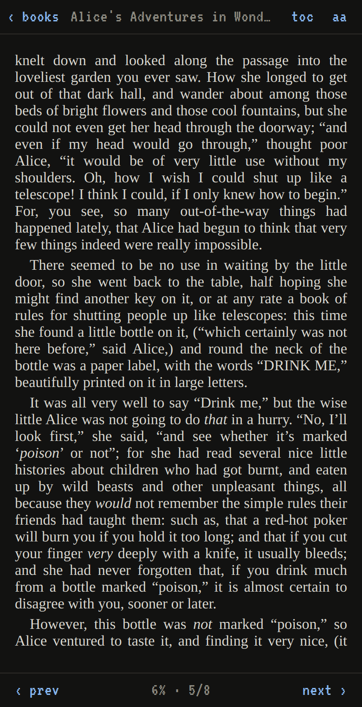
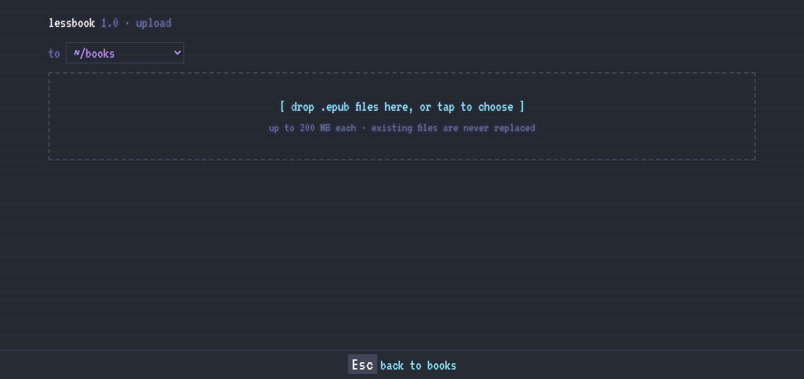

# lessbook

A tiny self-hosted EPUB reader for the browser. Put `.epub` files in a folder, open the page, and read on your phone or computer.

lessbook is a few static files served by nginx. It has no database, no build step and no app server. The library is the folder itself: add or remove books and the list updates.



## Features

- **Library**: a terminal-style `ls -l` listing of your books folder. It shows size, date and how far you've read, and subfolders work.
- **Find** (`f` or `/`): filters the list as you type.
- **Sort** (`s`): by name, newest, most read or largest.
- **Upload** (`u`): add EPUBs from the browser, including from a phone.
- **Reader**: paginated, one column at a comfortable line length. Turn pages by tapping the edges, swiping, or using the arrow keys or space. It has a table of contents, text size and fonts (serif, sans, mono, VT323 or the book's own).
- **Themes**: auto (follows the device), light, dark, sepia and Dracula.
- **Remembers your place** in each book, to the exact page, across all your browsers and devices.
- **Self-contained**: nothing loads from a CDN, and no fonts or scripts come from third parties.

## Screenshots

| Reader with the contents list (Dracula, VT323) | Reader settings (sepia) |
|---|---|
|  |  |

<p>
  
  
</p>



Books shown are public-domain titles from [Project Gutenberg](https://www.gutenberg.org/).

## How It Works

- nginx serves the pages and lists the books folder as JSON (`autoindex_format json`). The browser draws the library from that list.
- The reader uses [epub.ts](https://github.com/likecoin/epub.ts) to render books in the browser.
- Reading position and progress are saved to one small file on the server (`books/.lessbook/progress.json`), so every browser picks up where you left off.

## Requirements

- Docker with Docker Compose v2.
- For anything beyond your own machine, a reverse proxy with authentication in front of lessbook. **lessbook has no login of its own**, and anyone who can reach it can read and upload books. See [Authentication](#authentication).

## Files

```
lessbook/
├── LICENSE                 AGPL-3.0
├── docker-compose.yml
├── nginx.conf              nginx site config (library listing, uploads)
└── www/
    ├── index.html          library
    ├── library.js
    ├── read.html           reader
    ├── reader.js
    ├── upload.html         upload page
    ├── upload.js
    ├── style.css           shared styles and themes
    └── vendor/
        ├── epub-ts.umd.js  epub.ts 0.7.3
        ├── jszip.min.js    JSZip 3.10.1
        ├── epub-ts-LICENSE.txt, jszip-LICENSE.txt
        └── fonts/
            ├── vt323-latin.woff2
            └── VT323-OFL.txt
```

## Quick Start

1. Get the files:

   ```sh
   git clone https://github.com/jmpinney/lessbook.git
   cd lessbook
   ```

2. Create the books folder **before** starting the container, as the user that will own the books. If Docker creates the folder instead, it belongs to root and uploads fail.

   ```sh
   mkdir books
   ```

3. Check your user and group IDs. The container runs as these, so uploaded files belong to you:

   ```sh
   id -u   # e.g. 1000
   id -g   # e.g. 1000
   ```

4. Edit `docker-compose.yml` (see [The Compose File](#the-compose-file)), then start it:

   ```sh
   docker compose up -d
   ```

5. Open `http://localhost:8080` (or whichever port you published).

## The Compose File

```yaml
services:
  lessbook:
    image: nginxinc/nginx-unprivileged:1.27.4-alpine
    container_name: lessbook
    restart: unless-stopped
    user: "1000:1000"                          # your `id -u`:`id -g`
    volumes:
      - ./books:/books                         # your EPUB folder (must be writable for uploads)
      - ./www:/srv/www:ro
      - ./nginx.conf:/etc/nginx/conf.d/default.conf:ro
    ports:
      - "8080:80"                              # http://<host>:8080
```

**Read-only library:** if you don't want uploads, mount the books folder with `:ro` and delete the `location /upload/ { ... }` block from `nginx.conf`. Reading works as normal; an upload attempt is refused (the upload page reports "folder not found"). Reading progress then stays in each browser instead of syncing.

## Authentication

lessbook doesn't handle logins. Put it behind something that does, for example:

- an auth proxy such as [Authelia](https://www.authelia.com/), [Authentik](https://goauthentik.io/) or [tinyauth](https://tinyauth.app/), configured on your reverse proxy;
- HTTP basic auth on your reverse proxy;
- a VPN such as WireGuard or Tailscale, so it's only reachable privately.

Whatever you use must protect **every** path, including `/books/` (the book files) and `/upload/`.

**Upload size through a proxy:** your reverse proxy must accept request bodies at least as large as lessbook's upload limit (200 MB by default). With nginx-based proxies that is `client_max_body_size 200m;` or more. nginx's default of 1 MB makes uploads fail with "larger than 200 MB" (HTTP 413).

## Uploads

- Open the upload page with `u` or the **upload** button in the library.
- Choose a destination folder, then drop files on the box or tap it to choose.

What nginx enforces (see `location /upload/` in `nginx.conf`):

| Rule | Response |
|---|---|
| Name must end in `.epub` (any case) | 403 otherwise |
| No hidden files or folders (names starting with `.`) | 403 |
| Never overwrites an existing file | 409 |
| Only into folders that already exist | 404 |
| Maximum size 200 MB | 413 |
| Only `PUT` on `/upload/`; `/books/` is read-only | 403 |

Notes:

- **The EPUB content check runs in the browser.** Someone with access who sends requests by hand could store a non-EPUB file with an `.epub` name. This is one more reason to keep lessbook behind authentication.
- **Folders** can't be created from the browser. Make them in the books folder on the server, and they appear in the library and the upload page's folder list (up to three levels deep).
- **Changing the size limit:** edit `client_max_body_size` in `nginx.conf` **and** `MAX` at the top of `www/upload.js`, then run `docker compose restart`. Raise your reverse proxy's limit to match.
- Uploads are written to `books/.lessbook-tmp` first and then moved into place, so a half-finished upload never shows up in the library.

## Using It

### Library

| Key | Action |
|---|---|
| `↑` `↓` or `j` `k` | Move the selection |
| `Enter` | Open the selected book or folder |
| `Backspace` or `h` | Up one folder |
| `f` or `/` | Find (`Esc` to close) |
| `s` | Change the sort: name, new, read, size |
| `u` | Upload |
| `t` | Change the theme |

### Reader

| Key or gesture | Action |
|---|---|
| Tap the right or left edge, swipe, `→` `←`, `Space`, `l` `h` | Next or previous page |
| `t` | Table of contents |
| `Esc` | Close a panel |
| `b` | Back to the library |
| **aa** button | Text size, font and theme |

The footer shows your progress through the whole book and the page within the chapter.

## Reading Progress

lessbook is meant for one reader. Your position and percentage read in each book are saved to `books/.lessbook/progress.json` on the server, a couple of seconds after you turn a page and again when you leave the reader. Opening a book on another browser or device picks up from there. Folders and files starting with `.` don't appear in the library, so this file stays out of sight.

Each browser also keeps a copy in `localStorage`, along with its settings (theme, font, text size, sort) and cached page locations. When the two copies differ, the newer one wins.

- To reset your progress everywhere, delete `books/.lessbook/progress.json`.
- Everyone who can reach lessbook shares the same progress.

## Troubleshooting

- **Uploads fail but the library works:** the books folder isn't writable by the compose `user`. Run `sudo chown -R "$(id -u):$(id -g)" books`.
- **Small uploads fail as "larger than 200 MB":** raise your reverse proxy's body size limit.

## License

Copyright © 2026 wafflemoon softworks

lessbook is free software: you can redistribute it and/or modify it under the terms of the [GNU Affero General Public License v3.0](LICENSE). If you run a modified version where others can use it over a network, you must offer them its source code. The bundled third-party files below keep their own licences.

## Third-Party Software

Bundled in `www/vendor/`, each with its licence alongside:

- [epub.ts](https://github.com/likecoin/epub.ts) 0.7.3 (fork of [epub.js](https://github.com/futurepress/epub.js)), BSD-2-Clause, © 3ook.com and FuturePress
- [JSZip](https://github.com/Stuk/jszip) 3.10.1, MIT or GPLv3 (dual licensed)
- [VT323](https://fonts.google.com/specimen/VT323) font, SIL Open Font License 1.1, © The VT323 Project Authors

Runs on the official [nginx unprivileged image](https://hub.docker.com/r/nginxinc/nginx-unprivileged).
